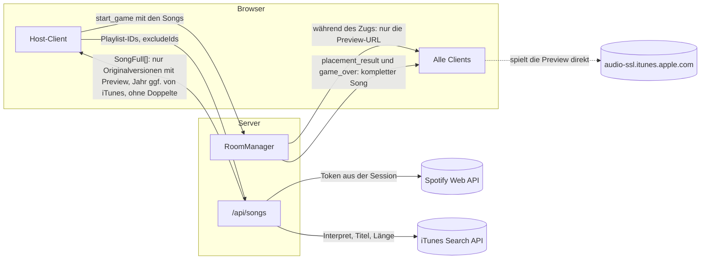
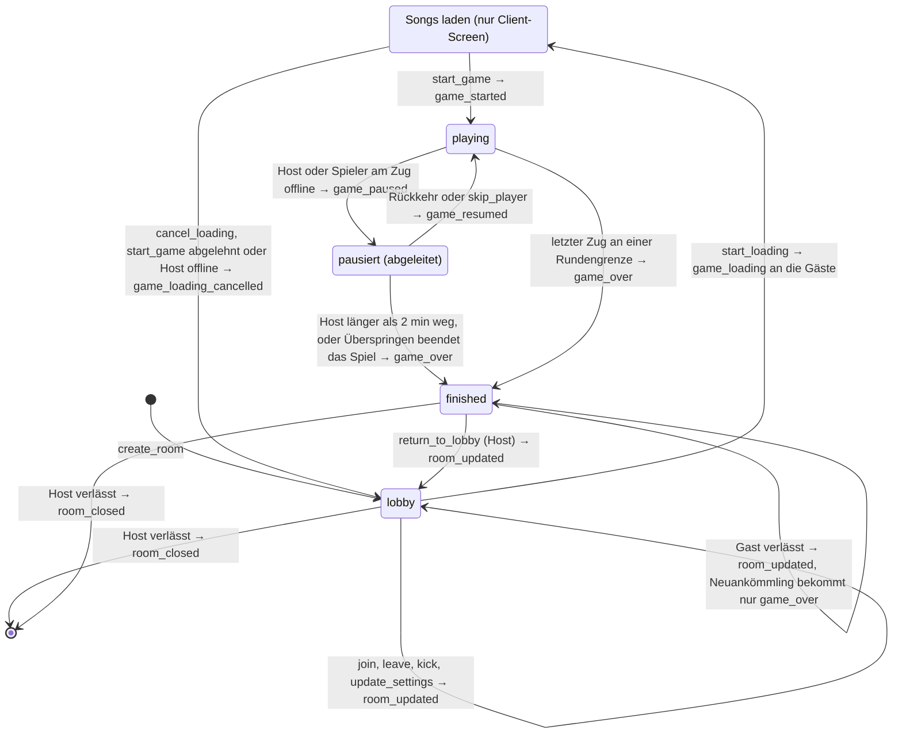
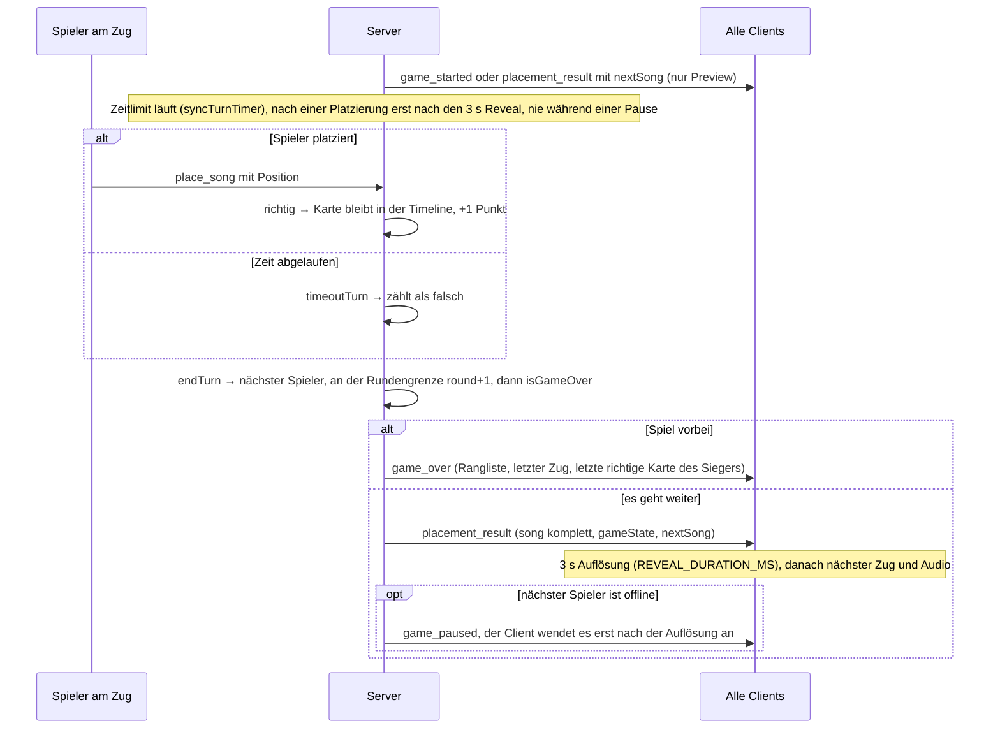
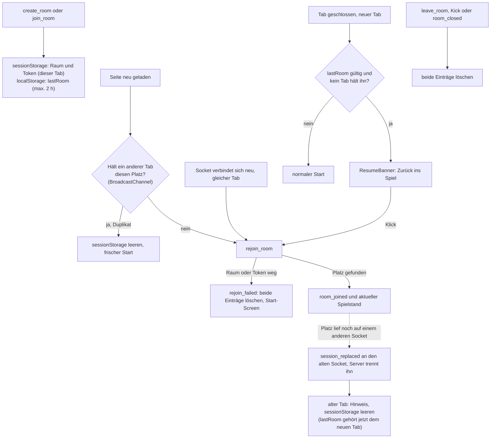
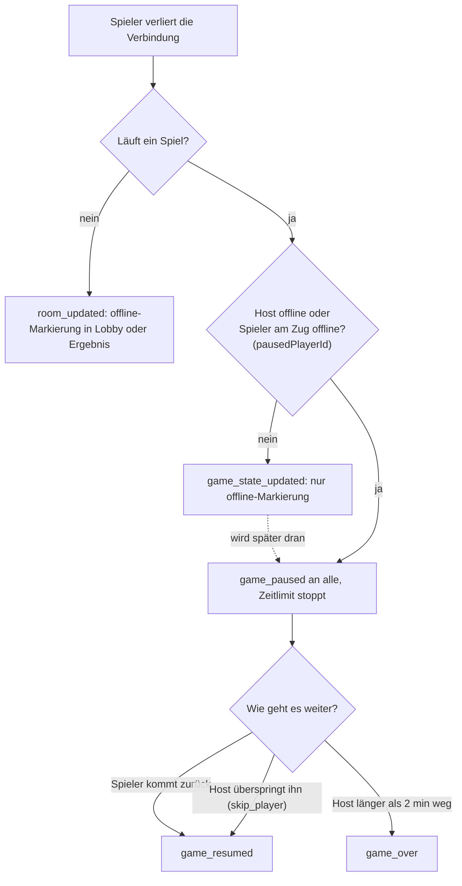

# Architektur: Räume, Züge und Sitzplätze

Diese Diagramme zeigen die Abläufe, die über mehrere Dateien verteilt sind und beim Umbauen am leichtesten kaputtgehen. Sie beschreiben den Stand des Codes. Wer die Logik ändert, passt bitte auch das Diagramm an.

Wichtigste Quellen:

- **Server:** `server/src/rooms.ts` (RoomManager, Timer), `server/src/game.ts` (Spielregeln), `server/src/app.ts` (Socket-Handler)
- **Client:** `client/src/hooks/useSocketEvents.ts`, `client/src/App.tsx`, `client/src/utils/roomStorage.ts`, `client/src/utils/tabPresence.ts`
- **Gemeinsam:** Event-Typen in `shared/src/index.ts`

## 1. Datenfluss: Songs und was wer wann sieht

Der Spotify-Token bleibt auf dem Server. Der Host-Client bekommt fertige Songs und reicht sie an den Spiel-Server weiter, der sie prüft (`isValidSong`). Während eines Zugs gehen nur die Preview-URLs an die Clients. Titel, Interpret, Cover und Jahr kommen erst mit der Auflösung, damit niemand vorsagen kann.

## 2. Raum-Zustände

Der Server kennt drei Status: `lobby`, `playing` und `finished`. „Songs laden“ und „pausiert“ sind keine eigenen Status. Das Laden ist nur ein Client-Screen, während der Raum in der `lobby` bleibt. Die Pause wird aus der Verbindung der Spieler abgeleitet (`pausedPlayerId`, siehe Abschnitt 5).

Weitere Regeln:

- **Verlassen und Kick:** `leave_room` geht in der Lobby und auf dem Ergebnis-Screen, nicht mitten im Spiel. Kicken kann nur der Host, und nur in der Lobby.
- **Spät Beitretende und Rückkehrer:** Wer während eines Spiels beitritt oder zurückkommt, wird per `seatPlayer` in die Reihenfolge aufgenommen. Wer noch keine Karte hat, bekommt eine Startkarte vom Stapel, wenn der reicht. Sonst schaut man bis zur nächsten Partie zu.
- **Aufräumen:** Ein Raum lebt 2 h; jede Aktion verlängert das. Ist niemand mehr verbunden, wird er nach 10 min gelöscht.
- **Rundenzahl:** `startGame` setzt `gameRounds` auf das, was der Stapel für alle hergibt. `rounds` bleibt die Einstellung des Hosts.

## 3. Ablauf eines Zugs

`isGameOver` beendet das Spiel nur an einer Rundengrenze, damit alle gleich viele Züge haben. Das passiert, wenn die Runden durch sind oder der Stapel keine volle Runde mehr hergibt. Mitten in einer Runde endet es nur, wenn gar kein Song mehr da ist.

## 4. Sitzplatz: Reload, geschlossener Tab, Duplikate

Ein Sitzplatz ist ein Token mit 48 Zeichen. Jeder Tab legt ihn in seinem `sessionStorage` ab; zusätzlich steht der zuletzt gespielte Raum als `lastRoom` im `localStorage` (max. 2 h).

`rejoin_room` legt nie einen neuen Spieler an. Ein Join mit Namen geht nur über `join_room`.

## 5. Pause-Regel

Nur zwei Ausfälle halten das Spiel an: der Host und der Spieler, der gerade dran ist. Einen fehlenden Spieler kann nur der Host überspringen („Ohne X weiterspielen“). Fehlt der Host selbst, kann niemand weitermachen. Deshalb endet das Spiel, wenn er länger als 2 Minuten weg ist (`HOST_RECONNECT_GRACE_MS`).

Ein übersprungener Spieler verliert seinen Platz in der Reihenfolge, seine Karten bleiben aber in der Rangliste. Kommt er zurück, setzt ihn `seatPlayer` wieder ein.
